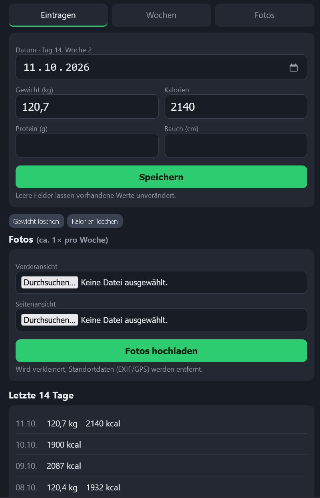

# Abnehm-Tracker

Kleine Web-App fürs Handy: tägliche Werte (Gewicht, Kalorien, Protein, Bauchumfang) eintragen.
Die Daten liegen in SQLite, daraus wird nach jedem Speichern automatisch eine Excel-Datei erzeugt.
Flask, `sqlite3` (ohne ORM), openpyxl. Keine Cloud, kein Tracking.



## Lokal starten

```
pip install -r requirements.txt
python app.py            # http://127.0.0.1:8099
python -m pytest         # Tests (pip install -r requirements-dev.txt)
```

Konfiguration über Umgebungsvariablen (Defaults in `config.py`):

| Variable | Bedeutung | Default |
|---|---|---|
| `DB_PATH` | SQLite-Datei | `data/tracker.db` |
| `XLSX_PATH` | Excel-Ausgabe | `data/tracker.xlsx` |
| `PHOTO_DIR` | Wochenfotos | `data/fotos` |
| `START_DATE` | Tag 1, muss ein Montag sein (Wochen laufen Mo–So) | `2026-09-28` |

## Deployment (Docker)

```
git clone <repo> && cd abnehm-tracker
cp .env.example .env     # DATA_DIR, BIND_IP, PUID/PGID anpassen
docker compose up -d --build
```

- `DATA_DIR` ist der Host-Ordner (z. B. `/mnt/storage1/abnehm-tracker`, per Samba freigegeben) mit `tracker.db` und `tracker.xlsx`.
  Er muss dem User `PUID:PGID` gehören bzw. für ihn beschreibbar sein.
- `BIND_IP` ist die LAN-/VPN-Adresse des Servers. Keine Port-Freigabe ins Internet.
- Es gibt keinen Login. Der Schutz ist das Netzwerk (Heimnetz/VPN).
- `tracker.db` nicht per Windows-Explorer öffnen oder verschieben, während die App läuft.
  Die Excel-Datei darf offen sein; dann wird sie beim nächsten Speichern aktualisiert.

## Update

```
bash scripts/update.sh      # Backup, git pull, Image neu bauen, Neustart
```

## Backup

`tracker.db` ist die einzige Datenquelle (Excel lässt sich daraus jederzeit neu erzeugen).
`bash scripts/backup.sh` legt ein konsistentes Backup in `DATA_DIR/backups/` ab (letzte 30).
Täglich per Cron: `0 3 * * * /pfad/zu/abnehm-tracker/scripts/backup.sh`

## Einmaliger Import von Altdaten

Wer Altdaten hat, schreibt sich ein kleines Skript, das `db.speichern(datum, kcal=…, gewicht=…)`
aufruft. Datum als ISO-Text (`YYYY-MM-DD`).

## Aufbau

| Datei | Zweck |
|---|---|
| `db.py` | Schema, Upsert, Abfragen |
| `auswertung.py` | Wochenberechnung, TDEE (ohne DB/Flask, getestet) |
| `excel_export.py` | Excel komplett neu erzeugen, atomar, mit Sperr-Handling |
| `chart.py` | Gewichtsverlauf als Inline-SVG |
| `app.py`, `templates/`, `static/` | Weboberfläche und PWA-Manifest |
